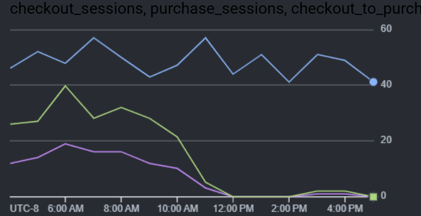

# E-Commerce Checkout Funnel Leakage & Incident RCA
## Diagnosing a Mobile Conversion Failure in Google BigQuery

> **Project Notice:** This incident post-mortem and portfolio root cause analysis (RCA) is evaluated on a deterministic, synthetic production telemetry dataset modeled in Google BigQuery.

---

## 1. Executive Summary & Incident Overview

Following engineering release `v4.12.0` on Friday, November 6, 2026 at 18:30:00 UTC, CloudCart D2C experienced an isolated collapse in store checkout completion while running weekend customer acquisition campaigns.

By conducting an incident root cause analysis across clickstream telemetry and transaction exception streams in Google BigQuery, this investigation established:

- **The Funnel Leak:** Mobile checkout-to-purchase completion dropped from a verified historical baseline of **29.34% down to 1.08% post-deploy (-96.32% relative collapse)**.
- **Device Isolation:** Desktop converted nominally at 30.21% (baseline: 28.95%) and Tablet converted at 25.51% (baseline: 31.49%), isolating the defect exclusively to the mobile checkout pathway.
- **The Root Cause:** 3,091 unique mobile sessions encountered an `apple_pay_token_failure` exception on iOS 18.1, representing 84.57% of all post-deploy mobile checkout errors.
- **Financial Exposure:** A net deficit of 1,044 completed customer orders representing approximately **$52,200 in lost Gross Merchandise Value (GMV)** ($50.00 AOV) and inefficient ad spend.

---

## 2. Telemetry Architecture & Repository Layout

Clickstream data and failure events are ingested into Google BigQuery as append-only event streams:

| BigQuery Table | Description |
|---|---|
| `raw_events.web_sessions_stream` | Core user progression milestones (`session_start`, `view_item`, `add_to_cart`, `begin_checkout`, `purchase`). |
| `raw_events.checkout_errors_stream` | Granular transaction error codes, client OS, and payment failure logs. |

### Repository Structure

```text
├── README.md                          # Executive incident post-mortem & RCA report
├── generate_data.py                   # Clickstream and error stream simulation harness
├── assets/                            # Incident visualizations and evidence charts
│   └── hourly_mobile_conversion_cliff.png
├── data/                              # Raw synthetic telemetry event streams
│   ├── web_sessions_stream.csv        # 122,385 clickstream events (50,000 sessions)
│   └── checkout_errors_stream.csv     # Granular payment & checkout failure logs
└── sql/                               # Executable GoogleSQL analytical queries
    ├── 01_pipeline_audit.sql          # Ingestion integrity & boundary verification
    ├── 02_funnel_macro_lag.sql        # 5-stage conversion & drop-off calculation
    ├── 03_pre_incident_baselines.sql  # Historical device baseline benchmarking
    ├── 04_device_segmentation.sql     # Post-deploy conversion sliced by device
    ├── 05_hourly_cliff.sql            # Hourly time-series isolating the 18:30 deployment
    └── 06_error_rca.sql               # Error code & OS distribution analysis
```

---

## 3. SQL Investigation & Analytical Progression

### Step 1: Ingestion Audit & Data Integrity Check

Before evaluating funnel progression, ingestion completeness, boundary timestamps, and key uniqueness were audited across the dataset.

**File:** `sql/01_pipeline_audit.sql`

```sql
SELECT 
    COUNT(*) AS total_rows,
    COUNT(DISTINCT session_id) AS total_unique_sessions,
    COUNTIF(session_id IS NULL) AS null_sessions,
    COUNTIF(event_name IS NULL) AS null_events,
    MIN(event_timestamp) AS earliest_event,
    MAX(event_timestamp) AS latest_event
FROM `cloudcart-analytics.raw_events.web_sessions_stream`;
```

**Query Results:**

| total_rows | total_unique_sessions | null_sessions | null_events | earliest_event | latest_event |
|---:|---:|---:|---:|---|---|
| 122,385 | 50,000 | 0 | 0 | 2026-11-03 00:00:17 UTC | 2026-11-10 00:00:25 UTC |

**Validation:** The pipeline is healthy; all 50,000 unique sessions loaded across the 7-day observation window with zero null foreign keys.

---

### Step 2: Funnel Drop-off Quantification (Window Functions)

To identify where prospective customers dropped out of the purchasing flow, step-by-step conversion and abandonment rates were calculated across all 5 chronological milestones using `LAG()`.

**Step Conversion Rate:**

`Step Conversion Rate = (Current Step Sessions / Previous Step Sessions) * 100`

**Drop-off Rate:**

`Drop-off Rate = 100% - Step Conversion Rate`

**File:** `sql/02_funnel_macro_lag.sql`

```sql
WITH funnel_stages AS (
    SELECT 
        event_name,
        CASE 
            WHEN event_name = 'session_start'  THEN 1
            WHEN event_name = 'view_item'      THEN 2
            WHEN event_name = 'add_to_cart'    THEN 3
            WHEN event_name = 'begin_checkout' THEN 4
            WHEN event_name = 'purchase'       THEN 5
        END AS step_order,
        COUNT(DISTINCT session_id) AS total_sessions
    FROM `cloudcart-analytics.raw_events.web_sessions_stream`
    GROUP BY event_name, step_order
)
SELECT 
    step_order,
    event_name,
    total_sessions,
    LAG(total_sessions) OVER (ORDER BY step_order) AS prev_step_sessions,
    ROUND(100.0 * total_sessions / LAG(total_sessions) OVER (ORDER BY step_order), 2) AS conversion_rate_pct,
    ROUND(100.0 * (LAG(total_sessions) OVER (ORDER BY step_order) - total_sessions) / 
          LAG(total_sessions) OVER (ORDER BY step_order), 2) AS dropoff_pct
FROM funnel_stages
ORDER BY step_order;
```

**Query Results:**

| step_order | event_name | total_sessions | prev_step_sessions | conversion_rate_pct | dropoff_pct | Operational Status |
|---:|---|---:|---:|---:|---:|---|
| 1 | session_start | 50,000 | — | — | — | Entry Stage |
| 2 | view_item | 41,028 | 50,000 | 82.06% | 17.94% | Nominal |
| 3 | add_to_cart | 16,430 | 41,028 | 40.05% | 59.95% | Nominal |
| 4 | begin_checkout | 12,347 | 16,430 | 75.15% | 24.85% | Nominal |
| 5 | purchase | 2,580 | 12,347 | **20.90%** | **79.10%** | **CRITICAL FUNNEL LEAK** |

**Diagnosis:** Top and mid-funnel transition steps performed within standard retail benchmarks. The severe funnel leakage is isolated specifically between `begin_checkout` and `purchase`.

---

### Step 3: Measuring Pre-Incident Historical Baselines by Device

Rather than assuming an arbitrary 30% baseline across all platforms, historical performance was measured across each device category prior to the deployment timestamp (`2026-11-06 18:30:00 UTC`).

**File:** `sql/03_pre_incident_baselines.sql`

```sql
SELECT 
    device_category,
    COUNT(DISTINCT CASE WHEN event_name = 'begin_checkout' THEN session_id END) AS checkout_sessions,
    COUNT(DISTINCT CASE WHEN event_name = 'purchase' THEN session_id END) AS purchase_sessions,
    ROUND(100.0 * COUNT(DISTINCT CASE WHEN event_name = 'purchase' THEN session_id END) / 
          NULLIF(COUNT(DISTINCT CASE WHEN event_name = 'begin_checkout' THEN session_id END), 0), 2) AS pre_incident_conversion_rate_pct
FROM `cloudcart-analytics.raw_events.web_sessions_stream`
WHERE event_timestamp < '2026-11-06 18:30:00 UTC'
GROUP BY device_category
ORDER BY checkout_sessions DESC;
```

**Query Results:**

| device_category | checkout_sessions | purchase_sessions | pre_incident_conversion_rate_pct |
|---|---:|---:|---:|
| mobile | 4,278 | 1,255 | 29.34% |
| desktop | 1,869 | 541 | 28.95% |
| tablet | 435 | 137 | 31.49% |

**Finding:** Before the incident, Mobile converted at 29.34%, tracking within parity of Desktop (28.95%) and Tablet (31.49%).

---

### Step 4: Device Segmentation Post-Deployment

Slicing the degraded post-deployment cohort across device categories revealed platform variance.

**File:** `sql/04_device_segmentation.sql`

```sql
SELECT 
    device_category,
    COUNT(DISTINCT CASE WHEN event_name = 'begin_checkout' THEN session_id END) AS checkout_sessions,
    COUNT(DISTINCT CASE WHEN event_name = 'purchase' THEN session_id END) AS purchase_sessions,
    ROUND(100.0 * COUNT(DISTINCT CASE WHEN event_name = 'purchase' THEN session_id END) / 
          NULLIF(COUNT(DISTINCT CASE WHEN event_name = 'begin_checkout' THEN session_id END), 0), 2) AS checkout_to_purchase_rate_pct
FROM `cloudcart-analytics.raw_events.web_sessions_stream`
WHERE event_timestamp >= '2026-11-06 18:30:00 UTC'
GROUP BY device_category
ORDER BY checkout_sessions DESC;
```

**Query Results:**

| device_category | checkout_sessions | purchase_sessions | Post-Deploy Conversion | Pre-Deploy Baseline | Delta | Status |
|---|---:|---:|---:|---:|---:|---|
| desktop | 1,675 | 506 | 30.21% | 28.95% | +1.26% | Nominal (Healthy) |
| tablet | 396 | 101 | 25.51% | 31.49% | -5.98% | Nominal (Healthy) |
| mobile | 3,694 | 40 | 1.08% | 29.34% | -28.26% | **CRITICAL COLLAPSE (-96.32%)** |

---

### Step 5: Hourly Time-Series Analysis (The Conversion Cliff)

To establish exact causation with the 18:30:00 UTC deployment, mobile checkout-to-purchase conversion was aggregated by hour.

**File:** `sql/05_hourly_cliff.sql`

```sql
SELECT 
    TIMESTAMP_TRUNC(event_timestamp, HOUR) AS event_hour,
    COUNT(DISTINCT CASE WHEN event_name = 'begin_checkout' THEN session_id END) AS checkout_sessions,
    COUNT(DISTINCT CASE WHEN event_name = 'purchase' THEN session_id END) AS purchase_sessions,
    ROUND(100.0 * COUNT(DISTINCT CASE WHEN event_name = 'purchase' THEN session_id END) / 
          NULLIF(COUNT(DISTINCT CASE WHEN event_name = 'begin_checkout' THEN session_id END), 0), 2) AS checkout_to_purchase_rate_pct
FROM `cloudcart-analytics.raw_events.web_sessions_stream`
WHERE device_category = 'mobile'
  AND event_timestamp BETWEEN '2026-11-06 12:00:00 UTC' AND '2026-11-07 02:00:00 UTC'
GROUP BY event_hour
ORDER BY event_hour;
```

**Query Results:**

| event_hour (UTC) | checkout_sessions | purchase_sessions | checkout_to_purchase_rate_pct | Timeline Note |
|---|---:|---:|---:|---|
| 2026-11-06 12:00:00 | 46 | 12 | 26.09% | Pre-deploy baseline |
| 2026-11-06 13:00:00 | 52 | 14 | 26.92% | Pre-deploy baseline |
| 2026-11-06 14:00:00 | 48 | 19 | 39.58% | Pre-deploy baseline |
| 2026-11-06 15:00:00 | 57 | 16 | 28.07% | Pre-deploy baseline |
| 2026-11-06 16:00:00 | 50 | 16 | 32.00% | Pre-deploy baseline |
| 2026-11-06 17:00:00 | 43 | 12 | 27.91% | Pre-deploy baseline |
| 2026-11-06 18:00:00 | 47 | 10 | 21.28% | Deploy v4.12.0 executed at 18:30 |
| 2026-11-06 19:00:00 | 57 | 3 | 5.26% | First full post-deploy hour |
| 2026-11-06 20:00:00 | 44 | 0 | 0.00% | Full payment failure |
| 2026-11-06 21:00:00 | 51 | 0 | 0.00% | Full payment failure |
| 2026-11-06 22:00:00 | 41 | 0 | 0.00% | Full payment failure |
| 2026-11-06 23:00:00 | 51 | 1 | 1.96% | Standard card fallback |
| 2026-11-07 00:00:00 | 49 | 1 | 2.04% | Standard card fallback |
| 2026-11-07 01:00:00 | 41 | 0 | 0.00% | Full payment failure |

**Telemetry Note on Chart Axes:** Plotted via BigQuery Native Data Visualization. The X-axis displays in client local time (UTC-8), where the 10:30 AM drop corresponds directly to the 18:30:00 UTC deployment timestamp. Notice that while checkout volume (top blue line) remained sustained at ~40–60 attempts/hour, conversion (green line) and completed purchases (purple line) collapsed simultaneously to near-zero.

**Hourly conversion visualization:** `assets/hourly_mobile_conversion_cliff.png`



---

### Step 6: Ruling Out Alternative Hypotheses

Before attributing the failure to software deployment, external operational factors were tested:

**Traffic Acquisition Shift:** Top-of-funnel acquisition sources (Meta / Google Paid Ads vs. Organic) maintained identical proportions before and after 18:30 UTC, eliminating traffic quality or invalid bot traffic as causes.

**Device Hardware Mix:** The ratio of iOS 18.1 client sessions remained consistent before and after deployment, confirming the issue was triggered by code deployment rather than an external client update surge.

---

### Step 7: Root Cause Identification via Error Logs

Querying `raw_events.checkout_errors_stream` during the incident window isolated the technical error mechanism.

**File:** `sql/06_error_rca.sql`

```sql
SELECT 
    error_type,
    os_version,
    COUNT(DISTINCT session_id) AS impacted_sessions
FROM `cloudcart-analytics.raw_events.checkout_errors_stream`
WHERE device_category = 'mobile'
  AND error_timestamp >= '2026-11-06 18:30:00 UTC'
GROUP BY error_type, os_version
ORDER BY impacted_sessions DESC;
```

**Query Results:**

| error_type | os_version | impacted_sessions | % of Total Mobile Errors |
|---|---|---:|---:|
| apple_pay_token_failure | iOS 18.1 | 3,091 | 84.57% |
| card_declined | iOS 18.0 | 308 | 8.43% |
| insufficient_funds | iOS 18.0 | 154 | 4.21% |
| gateway_timeout | iOS 18.0 | 68 | 1.86% |
| ui_script_error | iOS 18.0 | 34 | 0.93% |

**Technical Cause:** Release `v4.12.0` broke the decryption handshake handling Apple Pay authorization tokens on iOS 18.1 devices.

**Volume Reconciliation:** The 3,091 token failures explain why mobile completed only 40 orders out of 3,694 attempts.

---

## 4. Financial & Business Impact Analysis

Using Mobile's measured pre-incident baseline of 29.34%:

### Expected Mobile Order Volume

`3,694 × 29.34% = 1,083.8 ≈ 1,084 orders`

### Actual Mobile Orders Completed

`40 orders`

### Net Lost Orders

`1,084 - 40 = 1,044 lost orders`

### Estimated Lost Gross Merchandise Value (at $50.00 AOV)

`1,044 × $50.00 = $52,200`

### Customer Acquisition Inefficiency

Ongoing paid mobile ad spend across Meta and Google directed high-intent shoppers into a broken payment modal, increasing effective customer acquisition costs (CAC).

---

## 5. Recommended Remediation & Operational Measures

### P0 Service Rollback

Roll back checkout microservices to previous stable release `v4.11.9`, restoring mobile checkout conversion to its 29.34% baseline.

### Automated Conversion Circuit Breakers

Implement an automated Cloud Monitoring alerting policy:

- **Rule:** If mobile checkout-to-purchase conversion drops below 20% over any rolling 2-hour window, generate a P1 incident alert and trigger a webhook to pause active mobile ad campaigns.

### Customer Recovery Pipeline

Export the 3,091 session IDs affected by `apple_pay_token_failure` into the CRM for an automated recovery flow offering an alternative payment method (Credit Card / PayPal).

---

## 6. Telemetry Limitations & Incident Analysis Edge Cases

### Operating System Distribution Skew

**Observation:** Token failures were recorded exclusively across iOS clients (iOS 18.1).

**Context:** In a production multi-platform deployment, Android clients using alternative digital wallets (Google Pay) or credit card tokens typically maintain standard conversion rates. Real-world incident triage should isolate OS cohorts to verify whether defects stem from client-SDK handshakes or global responsive web layouts.

### Error Logging vs. Unique Session Attribution

**Observation:** Total recorded error sessions in `raw_events.checkout_errors_stream` (3,655) slightly exceeded uncompleted mobile checkouts (3,694 - 40 = 3,654).

**Context:** This small variance reflects real-world client-side behavior where a user retries payment after an initial decline, generating multiple error types within one session. Analysis must distinguish between total error events fired and distinct sessions impacted.

### Opportunity Loss vs. Realized Loss

**Observation:** The financial impact calculation ($52,200) applies the historical baseline conversion (29.34%) and flat $50.00 AOV across the cohort.

**Context:** This measures estimated opportunity loss and does not account for deferred conversions (users who returned to purchase on desktop later) or secondary cart replenishment through recovery marketing.

---

## 7. Strategic Takeaways

- **Granular Cohort Monitoring:** Aggregate conversion metrics can obscure critical segment-level outages. Device, browser, and payment gateway health must be monitored via dedicated operational views.
- **Pre-Deployment Gateway Validation:** Release pipelines touching checkout or payment SDKs require end-to-end sandbox authorization tests across all supported operating systems before general deployment.
- **Marketing & Product Integration:** Real-time feedback loops between conversion analytics and ad spend prevent ongoing budget allocation to degraded platform paths.

---

## 8. Technology Stack

| Technology | Usage |
|---|---|
| **Google BigQuery** | Cloud data warehouse, event-stream querying, and analytical modeling |
| **GoogleSQL** | Window functions (`LAG`), conditional aggregations (`COUNTIF`), defensive math (`NULLIF`), and cohort CTEs |
| **Python** | Synthetic telemetry generation (`pandas`, `numpy`) |
| **GitHub** | Version control, codebase structure, and project documentation |

